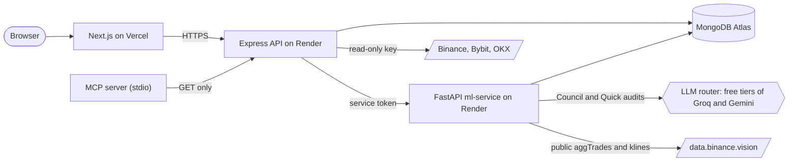

# FillScore: Execution Quality Auditing


FillScore is an independent, open-source **execution auditor** for crypto traders. It does not ask whether you were right about the market. It asks how well your orders were executed, and it answers from real public market data. You connect a **read-only** exchange key, FillScore reads your own past trades, and it measures what each order cost: the spread you paid, how far the price moved with you, what unfilled orders cost, and your fees against the rates your account qualifies for. **It audits the past. It never predicts, signals or advises.** Every number shown to a user comes from deterministic, tested code; language models may explain a finding, and they never produce a number.

**Live:** <https://fill-score-kappa.vercel.app>. Three demo accounts (synthetic trader behaviour on real January 2024 Binance prints) need no sign-up. No real user has been scored yet.

## Check it yourself

You do not have to trust FillScore to check a result.

1. **The verify page.** <https://fill-score-kappa.vercel.app/verify> checks a signed evidence pack in your browser; the file is not uploaded.
2. **The offline verifier.** `node scripts/verify_evidence_pack.mjs pack.json --key fillscore-public.pem` uses only Node's built-in crypto: no install, no network, no FillScore server. Exit 0 means the pack is consistent and was signed by the key you passed.
3. **The key fingerprint.** `curl https://fillscore-api.onrender.com/api/evidence/public-key` answered `ba11aa53c4961be4` (Ed25519) on 2026-11-22. Compare it with the fingerprint on the verify page, and get the public key from a source you trust, not from the pack.
4. **The score itself.** Each v2 score carries a version and an integrity hash that `GET /api/audit/verify` recomputes from the stored inputs.

## Architecture



Source of the layout: `ARCHITECTURE.md` and `docs/runbooks/DEPLOY.md`; the router's models and order are in `ml-service/config/llm_routes.yaml`.

## Evaluation

What the offline evaluation of the Agent Council found, and what it did not. `python ml-service/evals/run_offline.py` judges every stored recording against six invariants; `python ml-service/evals/ablation.py --check` confirms that the committed tables (`ml-service/evals/ablation_results_v3.md`) equal what the recordings produce (exit 0, no output). Both were run on 2026-11-22.

| Arm | Runs | Invariants per run | Gated violations | `evidence_cited` misses (measured) | Flagged by claim rules 1.2.0 | Flagged by claim rules 1.3.0 |
|---|---|---|---|---|---|---|
| Nine-call Council | 18 | 6 | 0 | 18 of 18 | 14 of 18 | 14 of 18 |
| Single call | 18 | 6 | 0 | 18 of 18 | 4 of 18 | 4 of 18 |

How to read it, plainly:
- The 36 recordings are three synthetic demo traders, six runs each, on two prompt versions. This is a small, descriptive check, **not** evidence that one arm is better. A claim rule judges the words of a run; a run can be flagged for one sentence.
- `evidence_cited` fails on every run of both arms: the recordings were made before the renderer fix that lets a run state the required value (`docs/research/LOG.md` §Z, §AB). It is reported, not gated.
- Claim rules 1.2.0 and 1.3.0 are measured on every recording, whatever rules it was made under. The current rules are 1.4.0 (2026-11-22); no recording was made under them.
- **The offline runner currently exits 1 with 3 violations.** The three committed demo Council runs were recorded again on 2026-11-22 under prompt 1.8.0 and metrics 1.4.0, and the golden set that owns those versions (`v4`, packets only) waits for the owner's permission to be created (`docs/PROGRESS.md`, "Waiting for Deepanshu").
- Source files: `ml-service/evals/ablation_results_v3.md`, `ml-service/evals/ablation_notes_v3.md`.

Tests, run on 2026-11-22: ml-service pytest 1810 passed and 5 failed (the 5 are the runner and golden-set checks named above); backend vitest 1053 passed (126 files), tsc clean; frontend vitest 727 passed (76 files), tsc clean, lint 0 errors; end-to-end 39 passed; MCP server 26 passed. The route table in `ARCHITECTURE.md` has 75 rows and a test keeps it equal to the code.

## Three pillars

1. **Measured.** Transaction-cost analysis (the methods used in regulated markets), on public data: Binance publishes every trade with its aggressor side, so the spread is *measured* from real prints, not inferred. Effective and realized spread, price impact, order-level implementation shortfall (including orders that never filled), real fee rates. Each number carries lineage: the public data files and their SHA-256. Method: [`docs/methodology/`](docs/methodology/) and the `/methodology` page, both generated from the code.
2. **Explained.** Plain-language findings whose numbers are true by construction: the model writes placeholders, code inserts the values, a claim check removes causal language, and a deterministic counterfactual replay verifies proposed findings. Ask a question about your own executions ("Ask your execution"): the answer comes from deterministic tools only.
3. **Verifiable.** Versioned scores with integrity hashes, and **signed evidence packs** (an Ed25519 signature over a manifest of every file with its SHA-256). See "Check it yourself" above.

## What it does today

- **Connect** Binance, Bybit or OKX with a read-only key. Each key is checked against the exchange and refused if it can trade or withdraw (fail closed). Keys are stored AES-256-GCM encrypted and never returned or logged.
- **Two scores, labelled.** *v1* is the original rule-based score (frozen; published grades never change). *v2* is measured: execution cost, fees and unfilled orders, equal weights, scored against data-derived anchors; timing is reported but not scored; a minimum of 20 fills and a bootstrap interval. Measurement is built for Binance; Bybit and OKX fills are synced, but their orders are not measured yet.
- **Cost against expectation.** For market orders: what they cost against the modelled cost of a taker event of the same size in the hour before the order (square-root impact model, fitted on January 2024, with a bootstrap interval over the orders), or "insufficient data". Real accounts read the hour from Binance's public 1-minute klines.
- **Explain and act.** A queue of orders that met a stated rule, with review states; a replay of one order with each figure linked to its stored source; rankings that say "too few to tell"; a matched comparison of your own fills across venues; PDF report and CSV export.
- **Quick and Deep audits.** One model call (default) or the nine-call Agent Council (opt-in, budgeted), both behind the same grounding, claim check and verification. **They audit one symbol (BTCUSDT on the dashboard), not the whole account**, and the page says so with the server's fill counts ("BTCUSDT only: 344 of the account's 607 fills" for `demo-moderate`).
- **A broker-file check.** Choose a Kraken Trades CSV, or map the columns of another broker's file (the only way a Coinbase file is read), and each fill is compared with the public price at its second. Nothing is stored. The Kraken reading is built from Kraken's documentation and is **not yet checked against a real file**.
- **Fresh data.** A scheduled re-sync of accounts older than 24 hours (only while the free instance is awake) and a "data last synced" line that says what stale data means.
- **For AI clients.** A read-only [MCP server](mcp-server/) with personal API keys (read-only, hashed, expiring, revocable), and an interactive scorecard that MCP-Apps clients show inside the conversation.
- **Open-source library.** [`fillscore-metrics`](packages/fillscore-metrics/): the measurement formulas as a dependency-free Python package, generated from the service's own code so it cannot drift.
- **Demo accounts.** Three Binance demos (`demo-disciplined` "Limit orders, daytime", `demo-moderate` "Mixed orders, mixed hours", `demo-aggressive` "Market orders, night"). Their trading behaviour is **synthetic**; every fill price comes from real public prints of January 2024. They are read-only.

## What it does not do, stated plainly

- **No real user has been scored yet.** The first real-account validation is a one-command harness (`ml-service/scripts/validate_real_account.py`) that waits for real trades.
- **The Kraken file reading and the CCXT comparison have not met a real file or a live account** (see `docs/PROGRESS.md`).
- **Perpetual funding costs, an EVM DEX wallet audit and cryptographic proof of where trades came from are not built.** The reasons (a read-only-key rule, an unvalidated detector, an unfinished protocol) are in [`docs/research/ZKTLS_FEASIBILITY.md`](docs/research/ZKTLS_FEASIBILITY.md) and `docs/milestones/M6.md`, `M7.md`.
- **Correlation, never causation.** "The price moved with your trade" is what the data shows; it does not say your trade moved it.
- The cost-vs-expected model is fitted on one month (January 2024) and says so.
- The Council's ablation (single call against nine calls) is small and on synthetic users; its re-recording is parked. Do not read a result into the tables above.

## Tech stack

| Layer | Technology | Port |
| :--- | :--- | :--- |
| Frontend | Next.js 16, React 19, TypeScript | 3000 |
| Backend | Node.js 20, Express, Mongoose, MongoDB Atlas | 3001 |
| ML service | Python 3.11, FastAPI, numpy | 8000 |
| MCP server | Node.js 20, MCP SDK | stdio |

## Quick start

**Prerequisites:** Node.js 20+, Python 3.11+, a MongoDB Atlas free-tier database. A Groq key (free) is needed only for the Council and Ask features.

```bash
git clone https://github.com/DeepanshuOP/FillScore.git
cd FillScore
# copy the .env.example files (backend/, ml-service/) to .env and fill them in; the values never go on a command line
scripts/dev.sh        # starts the frontend, backend and ml-service; logs in .work/logs/
```

The demo accounts need data in the database, which the project owner seeds deliberately (the seed scripts are guarded and must not be run
against data you care about; see [CONTRIBUTING.md](CONTRIBUTING.md)). The checks, with the exact commands that CI runs, are in
[CONTRIBUTING.md](CONTRIBUTING.md). A small, polite load test is in [`scripts/k6_smoke.js`](scripts/k6_smoke.js) (local targets only).

## Repo structure

```text
FillScore/
├── backend/                  # Express API: accounts, keys, sync, audit routes, evidence packs, API keys
├── frontend/                 # Next.js app: dashboard, /verify, /check, /methodology, settings
├── ml-service/               # FastAPI: measurement (measure/), scoring_v2/, expected_cost/, agents/ (Council, Ask),
│                             #   csv_import/, dp_baselines/, whale/ (older study)
├── mcp-server/               # read-only MCP server and the scorecard MCP App
├── packages/fillscore-metrics/  # the open-source formulas
├── shared/                   # the field registry
└── docs/                     # roadmap, milestones, methodology, research record, decisions (ADRs)
```

## Documentation

- [ARCHITECTURE.md](ARCHITECTURE.md): how the services fit together, the API surface (test-enforced), the data model, what is not built
- [SECURITY.md](SECURITY.md): threat model, known limits, how to report a vulnerability
- [CONTRIBUTING.md](CONTRIBUTING.md): the product rules and how to run the checks
- [docs/DEPLOY.md](docs/DEPLOY.md): Render (backend and ml-service) and Vercel (frontend)
- [docs/ROADMAP.md](docs/ROADMAP.md), [docs/milestones/](docs/milestones/): the roadmap and one report per milestone
- [docs/research/](docs/research/): the research record: findings, experiments, decisions, the 2026-11 audit, market research

## License

MIT, see [LICENSE](LICENSE).

## Disclaimer

FillScore audits historical execution quality. It does not provide trading signals, investment advice, or predictions of future prices. The demo accounts are synthetic trader behaviour evaluated against real Binance public prints (January 2024).
